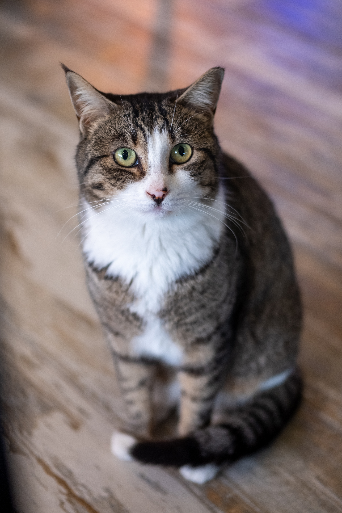

# gen-ai-styles

Style definitions for AI image generation. Each style is one JSON file in `image-styles/`.

## Baseline image

[`image-styles/_baseline.png`](image-styles/_baseline.png) is the source photo to test the styles.

[CC0](https://creativecommons.org/publicdomain/zero/1.0/) licensed [photo](https://wordpress.org/photos/photo/2416364cad/) by [vatoyiit](https://wordpress.org/photos/author/vatoyiit/) from the [WordPress Photo Directory](https://wordpress.org/photos/).

## Styles

| Style | Example | Summary |
|---|---|---|
| [Art Nouveau Watercolor](https://raw.githubusercontent.com/omahasdev/gen-ai-styles/main/image-styles/Art%20Nouveau%20Watercolor.json) |  | Art Nouveau-inspired 2D illustration for any subject: flowing ink contours, ornamental framing, muted jewel tones, watercolor-like shading on paper texture |
| [Art Nouveau Character Arch](https://raw.githubusercontent.com/omahasdev/gen-ai-styles/main/image-styles/Art%20Nouveau%20Character%20Arch.json) |  | Modern flat-color character poster: full-body figure in a tall pale arch on a dark background, dark ink outlines, large stylized flowers |
| [Vintage Cozy Storybook Illustration](https://raw.githubusercontent.com/omahasdev/gen-ai-styles/main/image-styles/Vintage%20Cozy%20Storybook%20Illustration.json) |  | Victorian and Edwardian storybook illustration: fine pen-and-ink hatching, layered watercolor and gouache, muted warm and cool palette, detailed cozy interiors |
| [Modern Happy Cartoon Illustration](https://raw.githubusercontent.com/omahasdev/gen-ai-styles/main/image-styles/Modern%20Happy%20Cartoon%20Illustration.json) |  | Modern happy cartoon illustration for any subject: very thick near-black outlines, rounded plush shapes, warm cel shading, simplified low-contrast backgrounds |
| [Uncanny Dream Logic Surrealism](https://raw.githubusercontent.com/omahasdev/gen-ai-styles/main/image-styles/Uncanny%20Dream%20Logic%20Surrealism.json) |  | Cinematic surrealism for any subject: a believable everyday scene with one unexplained contradiction, deadpan absurd humor, low-key warm-cool lighting, analog film grain |
| [Anime Isekai Comedy](https://raw.githubusercontent.com/omahasdev/gen-ai-styles/main/image-styles/Anime%20Isekai%20Comedy.json) |  | Mid-2010s Japanese fantasy-comedy TV anime frame for any subject: thin colored outlines, flat two-tone cels, large designed eyes, off-model comic acting, clean painted backgrounds in an earthy palette |

The examples are made from the baseline image with ChatGPT.

More ChatGPT examples of each style, with the source photo and the main example side by side: [`image-styles/examples/`](image-styles/examples/README.md).

## Usage

- Most of each file describes the visual language: the necessary features, the optional features, and the features to avoid.
- `style_prompt` is the positive prompt. Add the subject, context, composition, and palette.
- `negative_prompt` goes into the negative prompt field. If the model has no such field, add its items as "Avoid: ...".

You can also give the full JSON file to a language model and ask for a prompt for a specific subject.

To apply the styles to your own images with a local ComfyUI, see [`comfyui/`](comfyui/README.md).

## License

[CC BY 4.0](LICENSE). This license does not apply to `image-styles/_baseline.png`. That photo is CC0, and the copyright stays with its photographer.
