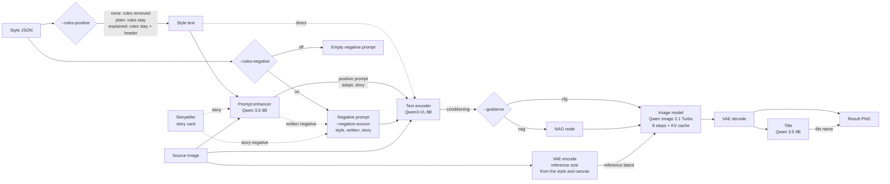
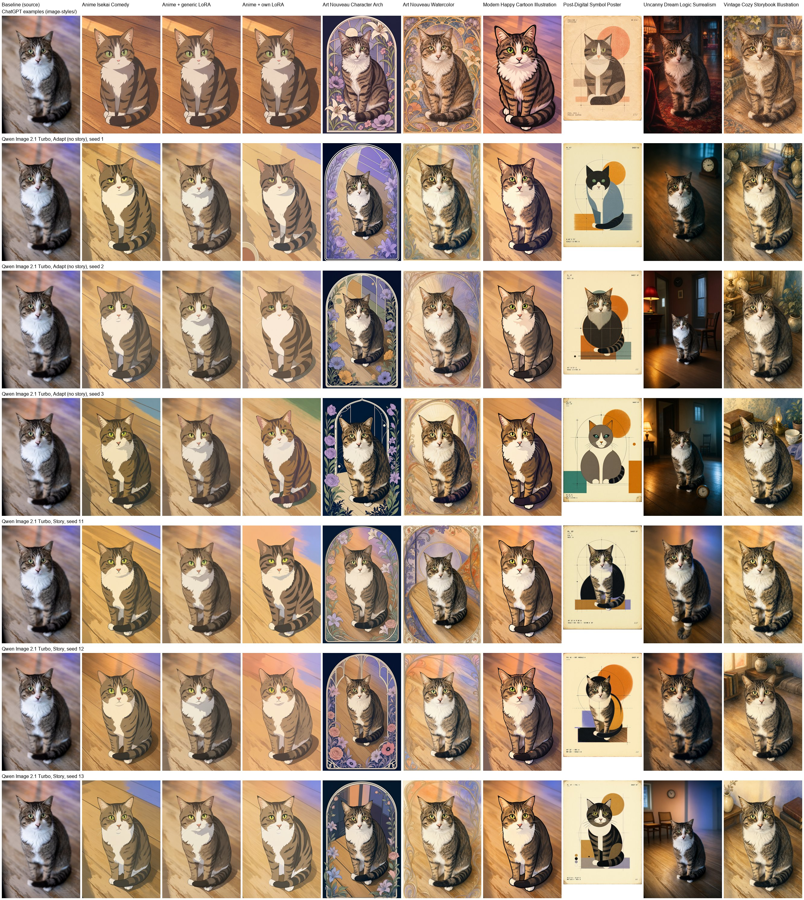

# Storyteller workflow

This workflow adds the storyteller, the identity notes, the prompt cleanup, and the LoRA routing to the [Enhancer workflow](../1-enhancer/README.md). See [`../README.md`](../README.md) for the comparison of the two workflows.

This folder redraws any image in any style of `image-styles/` with a local ComfyUI. It uses **Qwen Image 2.1 Turbo**, an 8-step image-edit model, in INT8. The model runs on a GPU with 12 GB VRAM.

The model gets the **complete** style file. There are three modes. They differ in who writes the positive prompt and in the scene of the picture:

| `--mode` | Who writes the positive prompt | Scene | Seeds | Time for each image |
|---|---|---|---|---|
| `direct` | Nobody: the style JSON goes straight to the image model | What the image model makes from the JSON; it often keeps the photo background | `--image-seed` | approximately 15 s |
| `adapt` | The prompt enhancer (Qwen 3.5 9B) | The style's own generic scene, from its background, setting, and frame sections | `--image-seed`, `--prompt-seed` | 3–9 min |
| `story` (default) | The [storyteller](../../storyteller/README.md) draws a scene concept, then the prompt enhancer writes the prompt | A different enrichment for each story seed (concept, moment, story details, environment), inside the rules of the style | `--image-seed`, `--prompt-seed`, `--story-seed` | 3–9 min |

`direct` is the plain JSON-to-image converter. It is good for a style that is mainly a medium and a frame (Character Arch, Watercolor, Cartoon). It is weak for a style that must build an environment (Uncanny, Storybook): the image model does not build a scene from rules, and the prompt enhancer does.

## How it works



For each pair of image and style, the sequence is:

1. **Style text.** `style_transfer.py` reads the style JSON and fills the placeholders that you give. `--rules-positive` and `--rules-negative` decide what happens to the "no" rules (see [The "no" rules and the negative prompt](#the-no-rules-and-the-negative-prompt)).
   - `direct`: the JSON goes to the text encoder with a short header.
   - `adapt` and `story`: the script renders the JSON as an indented outline, with the same keys, nesting, and order, but without quotes. In `story` mode, the storyteller also draws a story card for the story seed: a concept, a setting, a story detail, a moment, a camera, and sometimes a homage. The style has priority over the card.
2. **Prompt enhancer** (`adapt` and `story`). The Qwen 3.5 9B prompt enhancer (`qwen3.5_9b_qwen_image_2.1_pe_i2i`) gets the source image, the request, and the system prompt `style-enhancer.system.md`. It writes one positive prompt of 400 to 800 words. The system prompt makes it apply every section of the style to the whole image, replace the photo background with the scene of the style, and keep each position, overlap, density, and exposure rule as precise as the style states it. When the style says nothing else, it also keeps four defaults: the subject in the medium of the style, natural sizes, a coherent focus, and a frame with an outer background as the border of the picture. It turns the "no" rules into positive statements, because the image model cannot read negation.
   - With `--negative-source written`, the same model then writes a negative prompt for this picture.
3. **Text encoder.** Qwen3-VL 8B (`qwen3vl_8b_int8_convrot`) encodes the positive prompt and the negative prompt together with the source image.
4. **VAE encode.** The VAE (`qwen_image_2.1_vae_bf16`) encodes the source image at the reference size into the reference latent (see [Reference size](#reference-size-subject-in-the-styles-medium)). The output is a separate empty latent with the canvas size, by default the source ratio at 1024 × 1536 pixels of area (see [Canvas](#canvas-output-size)).
5. **Image model.** Qwen Image 2.1 Turbo (`qwen_image_2.1_turbo_int8_convrot`) samples 8 steps with euler and fixed sigmas. Without a negative prompt, it runs at cfg 1. With a negative prompt, `--guidance` applies it through cfg or through the NAG node. The KV cache keeps the attention keys and values of the prompt and the reference image.
6. **VAE decode.** The VAE decodes the latent into the result PNG.
7. **Title** (`adapt` and `story`). The prompt enhancer model looks at the finished picture and writes a title of 3 to 7 words for the file name.

The three models do not fit into 12 GB VRAM together. ComfyUI keeps them in pinned RAM and moves each one to the GPU for its step. ComfyUI also caches the output of the last job. With the same image, style, and prompt seed, a new image seed runs only steps 3 to 6 again.

## Examples



Column 1 of each row has the source photo [`image-styles/_baseline.png`](../../image-styles/_baseline.png). The next columns have the styles in alphabetical order, without a LoRA. Directly after the Anime Isekai Comedy column, two more columns have the same style with a LoRA:

- Anime + generic LoRA: the 2anime entry of `loras.json`, given by hand with `--extra-lora`
- Anime + own LoRA: a style LoRA made with [`lora-training/`](../../lora-training/README.md)

The rows are:

- Row 1: the example images of `image-styles/`, made with ChatGPT
- Rows 2 to 4: `adapt` mode, seeds 1, 2, and 3
- Rows 5 to 7: `story` mode, seeds 11, 12, and 13

All generated rows use these models:

- Image model: Qwen Image 2.1 Turbo, `qwen_image_2.1_turbo_int8_convrot.safetensors`, 8 steps, cfg 1, 1024 px
- Text encoder: Qwen3-VL 8B, `qwen3vl_8b_int8_convrot.safetensors`
- Prompt enhancer: Qwen 3.5 9B, `qwen3.5_9b_qwen_image_2.1_pe_i2i.int8_convrot.safetensors`, thinking on
- VAE: `qwen_image_2.1_vae_bf16.safetensors`

To make the sheet again, run `python comfyui/2-storyteller/make_example_sheet.py --work sheet-work --sheet example-sheet.jpg`. Choose other rows with `--adapt-seeds` and `--story-seeds`. All generations go into the `--work` folder with telling names. Use `--layout folders` for one subfolder for each mode and seed. A run skips each result that is already in `--work`.

To add the LoRA columns, give one `--variant LABEL=OPTIONS` for each column. The options go to `style_transfer.py` for the `--variant-style` style (default: Anime Isekai Comedy):

```bash
python comfyui/2-storyteller/make_example_sheet.py --work sheet-work --sheet example-sheet.jpg \
    --variant "Anime + generic LoRA=--no-loras --extra-lora Nick_2anime_QwenImage2.1.safetensors:0.8:2anime" \
    --variant "Anime + own LoRA=--no-loras --extra-lora 'my_lora.safetensors:1.0:mystyle style'"
```

## Files

| File | Use |
|---|---|
| `style_transfer.py` | Batch script: images × styles → PNG files. Standard library only. |
| `make_example_sheet.py` | Makes the example sheet above. Needs Pillow. |
| `style-enhancer.system.md` | The system prompt of the prompt enhancer |
| `style-transfer.api.json` | The API graph that the script sends to ComfyUI |
| `style-transfer.workflow.json` | A simple graph for the ComfyUI editor, without the enhancer (drag the file into the window) |
| `custom_nodes/qwen-image21-nag/` | The NAG node for `--guidance nag` (see [Requirements](#requirements)) |
| `prompt_hygiene.py` | Cleanup, leak check, audit, and key of a written prompt (used by the prompt store) |
| `style_schema.py` | The schema of a style file and a validator: `python comfyui/2-storyteller/style_schema.py image-styles` |
| `graph_check.py` | Checks a graph against the node list of a server (`--check-graph`) |
| `lora_routing.py`, `loras.json` | LoRA routing: the registry of the local LoRAs, and the code that selects them for each style (see [LoRAs](#loras)) |
| `source_cleanup.py` | Source cleanup: fills a fault of the photo at the frame edge (an out-of-focus object in front of the lens) before the image model and the writer see the photo |
| `tests/` | Unit tests, CPU only, no server: `python -I -m unittest discover -s comfyui/2-storyteller/tests` |

`story` mode uses the storyteller module and its config from [`storyteller/`](../../storyteller/README.md) of the repository root.

## Requirements

- ComfyUI 0.45 or later (it has the native nodes `TextEncodeQwenImage21` and `QwenImage21Cache`)
- PyTorch with CUDA 13 (`cu130`). With `cu128`, ComfyUI disables the optimized CUDA kernels of `comfy_kitchen`, and the INT8 model runs on the slow fallback backend.
- An NVIDIA GPU with 12 GB VRAM and 32 GB RAM or more
- For `--guidance nag` only: copy the folder `custom_nodes/qwen-image21-nag` into the `custom_nodes` folder of your ComfyUI, then restart ComfyUI.

Download the model files (from [Comfy-Org/Qwen-Image-2.1](https://huggingface.co/Comfy-Org/Qwen-Image-2.1)) into your ComfyUI `models` folder:

| Folder | File | Size |
|---|---|---|
| `diffusion_models/` | [qwen_image_2.1_turbo_int8_convrot.safetensors](https://huggingface.co/Comfy-Org/Qwen-Image-2.1/resolve/main/diffusion_models/qwen_image_2.1_turbo_int8_convrot.safetensors) | 7.3 GB |
| `text_encoders/` | [qwen3vl_8b_int8_convrot.safetensors](https://huggingface.co/Comfy-Org/Qwen-Image-2.1/resolve/main/text_encoders/qwen3vl_8b_int8_convrot.safetensors) | 9.4 GB |
| `vae/` | [qwen_image_2.1_vae_bf16.safetensors](https://huggingface.co/Comfy-Org/Qwen-Image-2.1/resolve/main/vae/qwen_image_2.1_vae_bf16.safetensors) | 0.7 GB |
| `text_encoders/` | [qwen3.5_9b_qwen_image_2.1_pe_i2i.int8_convrot.safetensors](https://huggingface.co/Comfy-Org/Qwen-Image-2.1/resolve/main/text_encoders/qwen3.5_9b_qwen_image_2.1_pe_i2i.int8_convrot.safetensors) (prompt enhancer, `adapt` and `story` modes) | 9.5 GB |

The model license is the [Qwen Research License](https://huggingface.co/Qwen/Qwen-Image-2.1/blob/main/LICENSE). It permits non-commercial use only.

## Usage

Start ComfyUI. Then run the script from the repository root:

```bash
# one image, one style (story mode)
python comfyui/2-storyteller/style_transfer.py my-photo.jpg --styles "image-styles/Art Nouveau Watercolor.json" --output results

# one image, all styles, all seeds fixed
python comfyui/2-storyteller/style_transfer.py photo.jpg --seed 42 --output results

# plain JSON-to-image conversion, fastest
python comfyui/2-storyteller/style_transfer.py photo.jpg --styles "image-styles/Art Nouveau Watercolor.json" --mode direct --seed 7

# the style's generic scene, written by the enhancer; a new prompt seed gives new details
python comfyui/2-storyteller/style_transfer.py photo.jpg --mode adapt --image-seed 1 --prompt-seed 3

# story mode: one story card, three images from it
python comfyui/2-storyteller/style_transfer.py photo.jpg --mode story --story-seed 11 --prompt-seed 11 --image-seed 1
python comfyui/2-storyteller/style_transfer.py photo.jpg --mode story --story-seed 11 --prompt-seed 11 --image-seed 2

# story mode with tuned story lines: always a homage, no Moment line
python comfyui/2-storyteller/style_transfer.py photo.jpg --seed 7 --story-line Homage=1 Moment=0

# the "no" rules as a negative prompt, applied with NAG at cfg 1
python comfyui/2-storyteller/style_transfer.py photo.jpg --mode direct --rules-negative on --guidance nag

# print the composed requests, do not contact the server
python comfyui/2-storyteller/style_transfer.py photo.jpg --dry-run
```

The default server address is `http://127.0.0.1:8188`. If your ComfyUI uses a different port, give it with `--server`.

### Options

`--help` lists the options in these groups:

| Group | Options |
|---|---|
| 1. Mode and seeds | `--mode`, `--direct-format` (`json` or `outline`), `--image-seed`, `--prompt-seed`, `--story-seed`, `--seed` (sets each seed that you do not give; an unset seed is random) |
| 2. Story | `--story-config FILE`, `--story-line LABEL=P` |
| 3. Canvas and reference | `--canvas` (`source`, `auto`, `portrait`, `landscape`, `square`), `--reference-size` (`auto`, `canvas`, or N) |
| 4. "No" rules and negative prompt | `--rules-positive`, `--rules-negative`, `--negative-source`, `--guidance`, `--guidance-scale`, `--nag-alpha`, `--nag-tau` |
| 5. LLM | `--prompt-thinking / --no-prompt-thinking`, `--prompt-words MIN-MAX`, `--prompt-max-tokens N`, `--title / --no-title`, `--title-language` |
| 6. Placeholders | `--subject`, `--context`, `--composition`, `--palette`, `--fill KEY=VALUE` |
| 7. Server and output | `--output`, `--server`, `--graph`, `--cache-device`, `--cache-dtype`, `--dry-run`, `--check-graph`, `--object-info FILE`, `--server-copy / --no-server-copy`, `--manifest / --no-manifest` |
| 8. Prompt store and image seeds | `--prompt-store FOLDER`, `--write-only`, `--written-prompt FILE`, `--leak-retry / --no-leak-retry`, `--image-seeds N` |

### File names

Each result is named like a ChatGPT image: after the decode, the enhancer model writes a short title with the main subject and the scene. The source, the style, the mode with its seeds, and the options that differ from the defaults come first, so the files sort by source and style, and no run overwrites another:

```text
<source> (<style>, <mode and seeds>[, <options>]) - <title>.png
_baseline (Art Nouveau Character Arch, adapt-s1) - Tabby cat in a vintage floral frame.png
_baseline (Art Nouveau Watercolor, story-i1-p2-c11, neg-written, nag1.5) - Cat on a garden path.png
_baseline (Vintage Cozy Storybook Illustration, direct-s1, pos-none, neg-style, cfg2).png
```

- The seeds show as `<mode>-s<N>` when all seeds of the mode are the same, else as `-i<image>-p<prompt>-c<story card>`.
- The option tags are `pos-none` or `pos-plain` (`--rules-positive`; the default `explained` has no tag), `neg-style`, `neg-written`, or `neg-story` (`--rules-negative on`), `cfg<scale>` or `nag<scale>`, `no-think`, `words…`, `ref<N>` or `refcanvas`, `canvas-<shape>` (a canvas other than `source`), `fmt-outline` (`--direct-format outline`), and `retry-think` or `retry-nothink` (the job ran again, see [Enhancer thinking](#enhancer-thinking-default-on)).
- `direct` mode and `--no-title` give no title. In `story` mode, the story slug then takes its place.
- In `adapt` and `story` modes, the written prompt is next to the image with the same name and `.prompt.txt`. A written negative prompt is in `.negative.txt`.
- Each result also gets a manifest `<name>.json`: the source, the style, and the code with their SHA-256 hashes, the mode, the seeds, the canvas, the reference size, the story card, the options, the models, and the retries. Tools read the manifest, not the file name. `--no-manifest` turns it off.

Choose the title language with `--title-language`, for example `--title-language Ukrainian`. The title step takes approximately 3 s for each image.

### The "no" rules and the negative prompt

The "no" rules of a style are its `avoid` lists, `negative_prompt`, `explicitly_not_the_style`, and `do_not_reproduce`. Two independent options decide where they go:

| Option | Values |
|---|---|
| `--rules-positive` | `none`: the rules are removed from the positive prompt. `plain`: they stay as plain data. `explained` (default): they stay, and the header says that they must not appear. |
| `--rules-negative` | `off` (default): the negative prompt is empty. `on`: the rules also go to the negative prompt. |

All six combinations are valid:

| | `--rules-negative off` | `--rules-negative on` |
|---|---|---|
| `--rules-positive none` | The rules are not used | The rules are only in the negative prompt |
| `--rules-positive plain` | The rules are plain data in the positive prompt | Plain data in the positive prompt, and the negative prompt |
| `--rules-positive explained` | The default: explained in the positive prompt | Explained in the positive prompt, and the negative prompt |

In `adapt` and `story`, the enhancer always turns the rules that it gets into positive statements, so `plain` and `explained` are the same there.

With `--rules-negative on`, `--negative-source` chooses the text of the negative prompt:

- `style` (default): the raw rules as a comma-separated list
- `written` (`adapt` and `story` only): the enhancer writes 20 to 40 phrases for this picture from the rules and the positive prompt that it wrote
- `story` (`story` only): as `written`, and the enhancer also gets the story card, so it can name the faults that this scene invites (wrong objects, light, or mood for the setting and moment)

`--guidance` chooses how the image model applies the negative prompt:

- `cfg` (default): classifier-free guidance. At cfg 1 the sampler ignores the negative prompt, because `uncond + 1 × (cond − uncond) = cond`. With a negative prompt, the default scale is 2.
- `nag`: Normalized Attention Guidance. The negative prompt steers the attention output of each block, and cfg stays at 1. The default scale is 1.5. Scale 2 and more break the image into collages and printed text on Turbo. This needs the `qwen-image21-nag` custom node.

Each negative prompt runs a second pass of the image model, so sampling takes approximately 2× time.

Measured effects (seed 1, the baseline photo):

| Setting | Result |
|---|---|
| `adapt`, negative prompt at cfg 2 | Almost no change against no negative prompt: the enhancer already writes the rules as positive statements |
| `direct --rules-negative on`, cfg 2 | A stronger medium for Watercolor, Storybook, and Cartoon (paper, ink, flat color), but a color drift of the subject in Character Arch |
| `direct --rules-positive none --rules-negative on`, cfg 2 | Worse than with the rules in the positive prompt: the Character Arch cat becomes a figure in a gown (the rules in the positive prompt protect the subject), and Uncanny prints text |
| `direct --rules-negative on`, NAG 1.5 | Storybook gets a full illustrated room, but printed text at the bottom |

A test with one fixed written prompt (Art Nouveau Character Arch, seed 1) compared cfg and steps without a negative prompt:

| Setting | Time | Result |
|---|---|---|
| Turbo, 8 steps, cfg 1 (default) | 12.7 s | Finished: fine linework, layered stems, detailed fur |
| Turbo, 8 steps, cfg 2 | 19.6 s | Flat and unfinished: blotchy fur fills, empty background planes |
| Base model, 25 steps, cfg 1 | 28.1 s | Finished, close to Turbo cfg 1 |
| Base model, 40 steps, cfg 1 | 31.5 s | The same as 25 steps |
| Base model, 40 steps, cfg 4 | 67.8 s | Flat and simplified, like Turbo cfg 2 |

More steps or the base model (`qwen_image_2.1_int8_convrot`) give no visible gain over Turbo.

### Enhancer thinking (default on)

The prompt enhancer reasons before it writes. The official Qwen Image 2.1 template notes that the enhancer was trained with a reasoning block and loses quality without it. In our tests, thinking was the strongest single improvement: the written prompt obeys hard rules of the style (exposure, frame, overlaps) much better, and the scenes become richer. Without thinking, the Uncanny style gave dark night scenes in 9 of 9 seeds, against the style's rule "most of the image clearly lit".

The cost is time: the enhancer writes up to 16,384 tokens at approximately 45 tokens/s (plain decoding with all weights in VRAM, the checkpoint has no multi-token prediction layers), so one image takes 3 to 9 minutes. Use `--no-prompt-thinking` for approximately 50 s for each image.

Two safety limits:

- With thinking, the reasoning sometimes uses the whole token budget and the enhancer writes no prompt. The image model then returns an unchanged copy of the source. The script detects an empty written prompt and runs the job again without thinking.
- Without thinking, the output is limited to 2,000 tokens. Above approximately 1,200 words, the enhancer starts to repeat and drift.
- Without thinking, the enhancer sometimes writes its own reasoning into the prompt (planning phrases, quoted checklist words, a draft of many lines). The image then drifts to realism. The script detects this and runs the job again with thinking (`--leak-retry`, default on). The file name gets the tag `retry-think`.

### Prompt store and two-phase run

With `--prompt-store FOLDER`, `adapt` and `story` run in two phases:

1. The enhancer writes the prompts of all jobs. The script removes a JSON wrapper or a code fence, checks the text for reasoning, and keeps it in `FOLDER/<key>.txt` with its data in `<key>.json`. The key is a SHA-256 of everything that decides the prompt: the model, the system prompt, the request, the source image, the seed, thinking, and the token limit.
2. The image model renders all jobs from the stored prompts.

The enhancer loads only once, so it keeps its full speed. A stored prompt is written only once and is reused for the same inputs: the enhancer does not give the same text twice for the same seed, so the stored text is the reproducible record. The results get no LLM title (the title step would load the enhancer again); the name has the story slug.

- `--write-only` writes and stores the prompts and renders nothing.
- `--written-prompt FILE` renders from one prompt file without the enhancer.
- `--image-seeds N` renders N images from each prompt, with the image seeds S to S + N - 1.
- `--check-graph` checks every graph of the run against the node list of the server (or a saved `/object_info` file with `--object-info FILE`) and queues nothing.
- `--no-server-copy` keeps no second copy of each result in the server's output folder (for experiments).

Measured written prompt lengths: 400 to 800 words. A longer target (`--prompt-words`) does not give longer useful prompts.

### Source cleanup

The image model copies the pixels of the source, so a fault of the photo at the frame edge (an out-of-focus object in front of the lens, a dark soft blob in a corner) comes back in the redraw even when the prompt describes a clean frame. Before the upload, `source_cleanup.py` finds such a blob and fills it from its surroundings. A region counts only when it touches the edge, is much darker than the pixels around it, is soft, covers a small part of the frame, and the frame is not low-key (dark scenes keep their dark edges). The manifest gives the filled part of the frame (`source_cleanup`). `--no-source-cleanup` turns it off.

### LoRAs

LoRAs are a booster beside the style pipeline. The style file, the storyteller, and the writer must give the style also without any LoRA. Only generic LoRAs route: a LoRA that gives a broad kind of look (for example photo to TV anime redraw) can go in the registry with `"scope": "generic"`. A LoRA of one concrete work, series, or style never goes in the registry, and the routing skips an entry without the generic scope. An entry with `"autoroute": false` stays in the registry but never routes automatically. Use it by hand with `--extra-lora`. The 2anime entry has this flag, because it keeps the eye size, the shading, and the background blur of the photo.

A style file never names a LoRA, because the same file also works in ChatGPT and Gemini. The script selects the LoRAs itself, from the local registry `loras.json`:

- Each entry names a LoRA file in `models/loras`, the diffusion model that it is for (a part of the model file name), its strength, and its trigger words.
- The `when` key of an entry gives key paths of a style and a regular expression. The entry applies to each style whose text at these paths matches the expression, for example "Japanese … animation" in the primary identity, the influences, or the medium.
- The script adds one LoRA loader (model only) for each selected entry, after the diffusion model. It also puts the trigger words in front of the prompt. The manifest of each result lists the LoRAs.
- An entry for another diffusion model, or a missing registry file, adds no LoRA. `--no-loras` turns the routing off, and `--loras FILE` uses another registry.

To add a LoRA, put the file in `models/loras` and add an entry to `loras.json`. Choose a pattern that only the intended styles match: the test `tests/test_lora_routing.py` fails when an entry matches no style or every style.

### Placeholders

Give values for the placeholders with `--subject`, `--context`, `--composition`, `--palette`, and `--fill KEY=VALUE` for a style-specific placeholder, for example `--fill "surreal_event=the clock melts over the shelf"`. If a placeholder has no value, the enhancer derives it from the image.

### Canvas (output size)

The output has the area of a ChatGPT image (1024 × 1536 pixels). `--canvas` chooses its shape:

| `--canvas` | Output |
|---|---|
| `source` (default) | The exact aspect ratio of the source image. The baseline photo (2:3) gives 1024 × 1536. |
| `auto` | One of the three ChatGPT sizes. In `story` mode, the Format line of the story card chooses it; in `direct` and `adapt`, the size nearest to the source ratio. |
| `portrait`, `landscape`, `square` | 1024 × 1536, 1536 × 1024, or 1024 × 1024 |

The Format line of the story card is filtered by the style's own composition text (`aspect_ratio`, `preferred_aspect_ratio`, `default_orientation`): "portrait" or "vertical" limits the draw to portrait, "flexible" only gives the named formats a higher weight, and "preserve the source" gives the source ratio. With a fixed canvas, the Format line names that canvas and draws nothing.

### Reference size (subject in the style's medium)

The image model gets the source twice: as vision tokens through the text encoder (what the subject is) and as a pixel reference (how it looks). With a full-size pixel reference, the model copies the photographic surface of the subject, so a photo cat sits in a drawn scene. Without a pixel reference, the subject is drawn in the style but loses its identity, for example a generic tabby instead of this cat.

A smaller pixel reference keeps the subject's shape, markings, and pose, but it has less surface detail to copy, so the subject is redrawn in the style's medium.

With `--reference-size auto` (default), the script derives the reference size from the style file and scales it to the canvas. It reads only generic fields of the `rendering` section, never the style name:

- The distance from a photo is the largest of `1 - realism_level`, `line_art_prominence`, and `painterly_rendering`. A style without these numbers gets a value from the medium words in `rendering.medium` and `technique`.
- The size goes from the full canvas side (distance 0, a photographic medium) down to 40 % of it (distance 1, a fully drawn medium). The canvas side is the side of a square with the canvas area: 1254 pixels for 1024 × 1536.

On the 1024 × 1536 canvas, this gives 512 pixels for Cartoon, 544 for Character Arch and Anime Isekai Comedy, 640 for Watercolor and Storybook, and 1152 for Uncanny. A new style file gets its size by the same formula. The dry run prints the canvas, the reference size, and its source.

Other values: `--reference-size canvas` uses the full canvas side for every style, like ChatGPT ("without backstage"). `--reference-size N` sets the size yourself, and `0` keeps the encoder default.

An earlier test on a 1024 × 1024 canvas found that the reference size does not change the "cat is too realistic" look of Storybook: 320, 448, and 512 pixels gave almost the same cat.

### Source softening and identity notes (people in a drawn style)

The image model edits on top of the source and keeps its contours: the face shapes, the eye size, and the skin shading of a photo stay, so a drawn style gets semi-real people. A blur of the whole frame frees the drawing, but it also removes the core details of the scene (a decoration, the light of a lamp) and moves the camera.

With `--source-soften auto` (default), only the people are blurred in the copy that the image model gets. A person mask (DeepLabV3 MobileNet from torchvision, the "person" class) finds them, and the scene stays sharp. The blur is 2.5 % of the long side for a fully drawn style and scales with the style's distance from a photo. A style nearer to a photo than 0.5 (Uncanny) gets no blur. A source without people, or a machine without the mask model, keeps the sharp source. The writer always sees the sharp source.

The blur uses only the pixels of the people, so a dark coat or a red gown keeps its own color and is not mixed with the wall behind it. Only the heads (the face and the hair) get the full blur: MediaPipe face detection finds them. The garments, the hands, and the props in the person mask get a quarter of it, so the image model keeps their folds, buckles, and shapes. A strong blur on the whole person made the garments look unfinished and erased a small prop that the mask counts as a person. Without MediaPipe, or for a person without a detected face, the whole person gets one blur. MediaPipe finds human faces only: a creature face gets the light blur. The scene outside the people gets a light blur too (0.4 of the head blur), so that the image model does not copy the fine photo texture of a sharp wall. `--source-soften N` sets the blur for every style, and `0` turns it off.

A blurred person cannot correct a fact that the written prompt drops: the glasses, the hair color, the color and the buckles of a garment. Thus, with `--identity-notes auto` (default: on when the source is softened for the style), a second short call of the writer model lists these facts from a crop of the people, and the list goes after the written prompt. For a main creature (a monster, an alien, a puppet), the list names the head, nose, ears, eyes, eyelids, and mouth compared with a human face, because without them a sagging creature face became a bald human head. The server cleans the list: only the first list, no notes, and no denied items, because the image model draws every named item, also an item after "no". The list ends with one sentence about the place behind the subjects: the material, the surface pattern, and the color family that the photo shows, so that the style's palette does not turn a cool place warm and a plain wall does not become a wall of blocks. The cleanup also drops the words for a photo blur (blurred, out of focus, bokeh), because the image model draws a blur that the prompt names. A style whose detail budget counts the shapes of a figure (for example 'three to eight large shapes') gets a short signature list: the position, the hair color and outline, the headwear shape, and the color of each large garment, and for a creature the outline of its head and ears, its hair, and its skin color (without it, a creature became a bald old man). A style that prints a face in one or two inks (its subject design names a duotone, monochrome, or grayscale face) gets gray faces in the copy for the image model: the image model kept the full color of the photo faces, also when the written prompt said duotone. Only the face box turns gray, so the hair keeps its color. The full list (stubble, studs, lacing, embroidery) made such a style draw near-photographic people. Without a list, the people became a flat sign, but the hat shape and the garment hue changed.

### Place check (story mode)

The story card can offer a setting (a meadow, a market) for a source "without a place of its own". With a long prompt, the writer sometimes misjudged a stone wall as no place and replaced it. With `--place-check auto` (default in story mode), the writer model first answers PLACE or PLAIN for the background of each source. For a place (a room, a hall, a wall, a floor, a landscape, also out of focus), the story card leaves out its Setting, Spot, Place details, and Time of day lines, so the place is adapted, not replaced, and keeps its own light (a lamp-lit evening line made the writer add lamps to a plain wall). The manifest records the answer in `source_place`. `--place-check off` lets the writer decide alone. For a place, the card also gets a Place line: the place is redrawn as it is, with no added furniture, window, door, lamp, or prop, and no sky where the input shows a wall. Only an element that a mandatory feature of the style asks for (an ornament, a surreal contradiction) can join the place: without this exception, a surreal style redrew a plain photo. A line of the card weighs more for the writer than a rule of its system prompt. For the same reason, every story card gets a Colors line: each person, animal, and creature keeps the hue of the input for the hair, the fur, the skin, and each garment, in the nearest palette color, and a hue never moves to a neighbor hue of the palette (a warm palette made black hair brown and a red jacket terracotta), and a very dark or very light part keeps its value. Each surface of the place keeps its color temperature, also under a warm or cool light. A Garments line asks that each garment keeps each of its layers and visible parts as separate clear shapes, each shape in the hue of that part in the input, as many shapes as the detail budget of the style allows (a style that turns a figure into a few flat shapes keeps that reduction), and that a dark garment is never a shapeless mass: the identity notes named a cape, but the writer drew the coat as one mass.

### Scene reading (story mode)

The story card used to ask only to keep the emotion of the photo, one step stronger, so the writer copied the faces of the photo and missed the context of the moment. With `--scene-reading auto` (default in story mode), the writer model reads each source before the card is drawn, as one moment of a story, in five lines: Moment (what happens and what each person tries to do), Feelings (for each person, the feeling, why, and the relation to the others), Tone, Acting (brows, eyelids, open eyes, mouth, head, hands, body line, and an emotion symbol when it fits), and Props (each story prop by its shapes, materials, and colors, and how it is held). The request names no style: a mood of the style in the request leaked into the reading (a tense face-off became a loving duo). It also says that a face can mean more than one thing (a wide-open mouth can be fear, rage, or joy), and that the context decides. A posed photo (a portrait, a poster) reads as the attitude of each person toward the viewer, not as a quarrel between them: a posed pair read as 'controlled fury' gave angry faces in a friendly cartoon style. A creature is named by its look, never by a guessed kind: a reading that called a sagging creature face 'reptilian' gave it a lizard snout. The Acting line asks for the same feeling a step stronger, never a different one, with a key for the eyelids: drooping upper lids read tired, bored, or sad, lids narrowed under lowered brows read anger or suspicion, and wide lids read surprise, fear, or joy. The permanent lines of a face (wrinkles, scars, a heavy brow ridge) are its shape, not an expression. A reading written as a JSON object becomes the labeled lines, and a list of denied feelings ('with no anger, no fear') is dropped. The model reads an enlarged copy of the source, without thinking mode (thinking spent all its tokens). The cleanup keeps the five lines and drops a self-check, a word count, closed eyes, and blur words. The card gets the reading as a Scene reading line after the Concept line, with a frame: act it out stronger and clearer in the means of the style, with the same feeling, and keep each prop at its size (a figure fixed to a prop stays a small part of it). The manifest records the reading in `scene_reading`. `--scene-reading off` leaves it out.

## Speed

Measurements on an RTX 4070 (12 GB), 128 GB RAM, Windows 11, ComfyUI 0.45, PyTorch 2.12.1+cu130, 1024 px, cfg 1. A negative prompt (cfg more than 1 or NAG) adds approximately 6–8 s for each image.

| Case | Time for each image |
|---|---|
| `story` or `adapt` with thinking (default) | 3–9 min |
| `adapt` without thinking, new style or new image | 44–57 s |
| `direct`, new style or new image | 10–17 s |
| `direct`, same image and style, new seed (conditioning reused) | 7.8 s |

Without thinking, the enhancer writes approximately 450 to 1,600 tokens. A loaded enhancer decodes at approximately 45 tokens/s. The first job after a block of `direct` jobs loads it again, and that job often decodes at only 8 to 29 tokens/s. Thus, do not mix `direct` jobs with `adapt` or `story` jobs in one batch.

Each new prompt costs approximately 6 s for the text encoder. The three models (9.5 GB, 9 GB, 7 GB) do not fit into 12 GB VRAM together. ComfyUI keeps all of them in pinned RAM and swaps them to the GPU for each phase. The sampling of 8 steps takes approximately 6 s.

### What helps

| Optimization | Result |
|---|---|
| PyTorch `cu130` instead of `cu128` | Enables the CUDA kernels of `comfy_kitchen` for INT8 |
| KV cache (`QwenImage21Cache`, `device=auto`) | Sampling 6.0 s against 9.3 s with `off` (1.55× faster). With the long `direct` prompt: 7.8 s against 16.9 s (2.2× faster). On by default. |
| KV cache `dtype=int8` | 5.9 s: no gain at 1024 px. Use it only if VRAM is full at higher resolution. |
| KV cache `device=cpu` | 7.2 s |
| Turbo model + INT8 weights | 8 steps at cfg 1, half the size of BF16 |
| Pinned memory + Dynamic VRAM | On by default on NVIDIA. ComfyUI pins up to 40 % of RAM, so the two models stay in RAM and swap fast. |
| All jobs in the queue at one time | The script does this, so the GPU does not wait between jobs |
| `--fast fp16_accumulation fp8_matrix_mult cublas_ops` | Approximately 7 % faster (11.5 s against 12.3 s). The output is identical to the output without the flag. |

### What does not help

| Option | Result |
|---|---|
| `--use-sage-attention` | No measurable gain. It changes the output, a lot for some styles. |
| `--highvram` | Harmful: the encoder and the model cannot stay in 12 GB together, and the GPU thrashes. |

Recommended launch arguments: `--fast fp16_accumulation fp8_matrix_mult cublas_ops`.
