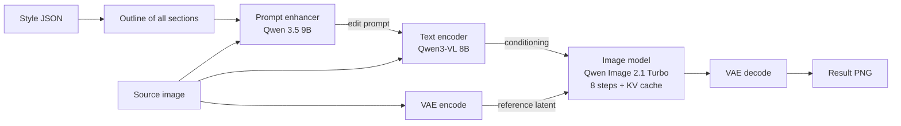
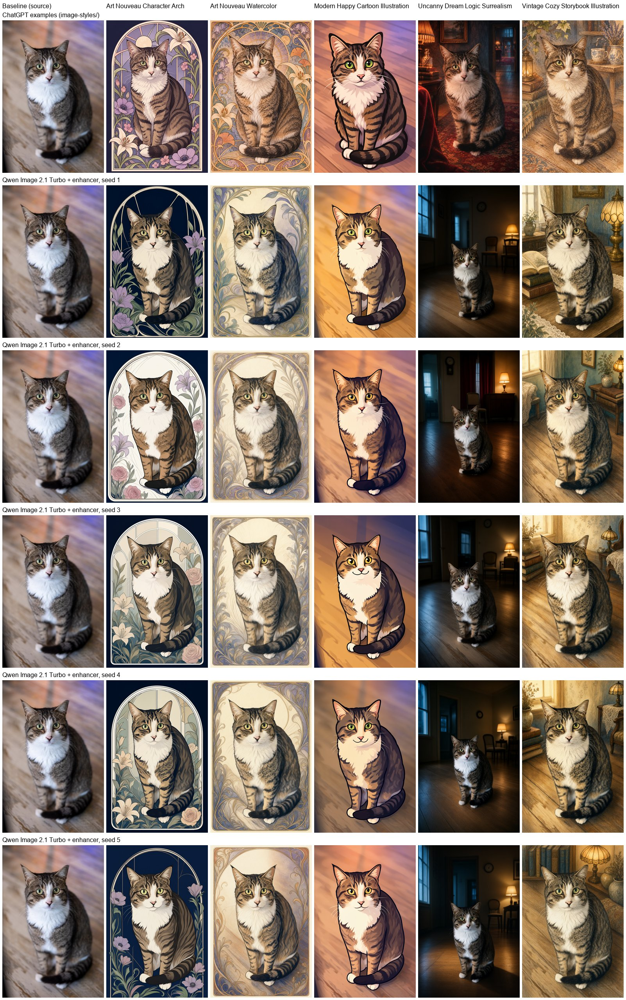

# ComfyUI style transfer

This folder redraws any image in any style of `image-styles/` with a local ComfyUI. It uses **Qwen Image 2.1 Turbo**, an 8-step image-edit model, in INT8. The model runs on a GPU with 12 GB VRAM.

The model gets the **complete** style file. The official Qwen Image 2.1 prompt enhancer, a Qwen 3.5 9B language model, reads the input image and all sections of the style JSON. Then it writes the edit prompt for the image model.

## How it works



For each pair of image and style, the sequence is:

1. **Style to outline.** `style_transfer.py` reads the style JSON and renders all 16 sections as an indented outline: the same keys, nesting, and order, without quotes. It fills the placeholders that you give.
2. **Prompt enhancer.** The Qwen 3.5 9B prompt enhancer (`qwen3.5_9b_qwen_image_2.1_pe_i2i`) gets three inputs: the source image, the outline, and the system prompt `style-enhancer.system.md`. It writes one edit prompt of 300 to 500 words. The prompt names the identity and pose of the subject, the medium, palette, light, texture, frame, and at least eight elements of the environment. It converts the "avoid" rules into positive statements, because the image model cannot read negation.
3. **Text encoder.** Qwen3-VL 8B (`qwen3vl_8b_int8_convrot`) encodes the edit prompt together with the source image into the conditioning.
4. **VAE encode.** The VAE (`qwen_image_2.1_vae_bf16`) encodes the source image, resized to approximately 1024 × 1024 pixels, into the reference latent. The output image gets the same aspect ratio.
5. **Image model.** Qwen Image 2.1 Turbo (`qwen_image_2.1_turbo_int8_convrot`) samples 8 steps with euler, fixed sigmas, and cfg 1. The KV cache keeps the attention keys and values of the prompt and the reference image, so that each step does not compute them again.
6. **VAE decode.** The VAE decodes the latent into the result PNG. The script saves the PNG and the written prompt (`.prompt.txt`).

The three models do not fit into 12 GB VRAM together. ComfyUI keeps them in pinned RAM and moves each one to the GPU for its step. ComfyUI also caches the output of each step. With the same image, style, and enhancer seed, a new image seed runs only steps 5 and 6 again.

## Examples



Column 1 of each row has the source photo [`image-styles/_baseline.png`](../image-styles/_baseline.png). Row 1 has the example images of `image-styles/`, made with ChatGPT. Rows 2 to 6 have 5 seeds of this workflow, made from the source photo with these models:

- Image model: Qwen Image 2.1 Turbo, `qwen_image_2.1_turbo_int8_convrot.safetensors`, 8 steps, cfg 1, 1024 px
- Text encoder: Qwen3-VL 8B, `qwen3vl_8b_int8_convrot.safetensors`
- Prompt enhancer: Qwen 3.5 9B, `qwen3.5_9b_qwen_image_2.1_pe_i2i.int8_convrot.safetensors`, thinking off
- VAE: `qwen_image_2.1_vae_bf16.safetensors`

To make the sheet again, run `python comfyui/make_example_sheet.py --work sheet-work --sheet example-sheet.jpg`.

## Files

| File | Use |
|---|---|
| `style_transfer.py` | Batch script: images × styles → PNG files. Standard library only. |
| `make_example_sheet.py` | Makes the example sheet above. Needs Pillow. |
| `style-enhancer.system.md` | The system prompt of the prompt enhancer |
| `style-transfer.api.json` | The API graph that the script sends to ComfyUI |
| `style-transfer.workflow.json` | A simple graph for the ComfyUI editor, without the enhancer (drag the file into the window) |

## Requirements

- ComfyUI 0.45 or later (it has the native nodes `TextEncodeQwenImage21` and `QwenImage21Cache`)
- PyTorch with CUDA 13 (`cu130`). With `cu128`, ComfyUI disables the optimized CUDA kernels of `comfy_kitchen`, and the INT8 model runs on the slow fallback backend.
- An NVIDIA GPU with 12 GB VRAM and 32 GB RAM or more

Download the model files (from [Comfy-Org/Qwen-Image-2.1](https://huggingface.co/Comfy-Org/Qwen-Image-2.1)) into your ComfyUI `models` folder:

| Folder | File | Size |
|---|---|---|
| `diffusion_models/` | [qwen_image_2.1_turbo_int8_convrot.safetensors](https://huggingface.co/Comfy-Org/Qwen-Image-2.1/resolve/main/diffusion_models/qwen_image_2.1_turbo_int8_convrot.safetensors) | 7.3 GB |
| `text_encoders/` | [qwen3vl_8b_int8_convrot.safetensors](https://huggingface.co/Comfy-Org/Qwen-Image-2.1/resolve/main/text_encoders/qwen3vl_8b_int8_convrot.safetensors) | 9.4 GB |
| `vae/` | [qwen_image_2.1_vae_bf16.safetensors](https://huggingface.co/Comfy-Org/Qwen-Image-2.1/resolve/main/vae/qwen_image_2.1_vae_bf16.safetensors) | 0.7 GB |
| `text_encoders/` | [qwen3.5_9b_qwen_image_2.1_pe_i2i.int8_convrot.safetensors](https://huggingface.co/Comfy-Org/Qwen-Image-2.1/resolve/main/text_encoders/qwen3.5_9b_qwen_image_2.1_pe_i2i.int8_convrot.safetensors) (prompt enhancer, `enhance` mode only) | 9.5 GB |

The model license is the [Qwen Research License](https://huggingface.co/Qwen/Qwen-Image-2.1/blob/main/LICENSE). It permits non-commercial use only.

## Usage

Start ComfyUI. Then run the script from the repository root:

```bash
# one image, one style
python comfyui/style_transfer.py my-photo.jpg --styles "image-styles/Art Nouveau Watercolor.json" --output results

# one image, all styles
python comfyui/style_transfer.py photo.jpg --output results

# a folder of images, two styles, fixed seed
python comfyui/style_transfer.py photos/ --styles "image-styles/Art Nouveau Watercolor.json" "image-styles/Modern Happy Cartoon Illustration.json" --seed 42 --output results

# print the composed prompts, do not contact the server
python comfyui/style_transfer.py photo.jpg --dry-run
```

The default server address is `http://127.0.0.1:8188`. If your ComfyUI uses a different port, give it with `--server`.

The results are `<image>__<style>.png`. In `enhance` mode, the written prompt is next to the image as `<image>__<style>.prompt.txt`.

### Prompt modes

| `--prompt-mode` | What the image model gets | Time for each image |
|---|---|---|
| `enhance` (default) | A prompt that the enhancer writes from the image and the complete style | approximately 50 s |
| `full` | The complete style JSON as the prompt | approximately 17 s |
| `compact` | `style_prompt`, `mandatory_features`, and the avoid list | approximately 12 s |

`enhance` gives the best results. The enhancer gets the style as an indented outline: the same keys, nesting, and order as the JSON, but without quotes. The enhancer treats quoted text as text to paint into the image. The enhancer converts every `avoid` list, `explicitly_not_the_style`, and `negative_prompt` into positive statements. This is necessary because the Turbo model runs at cfg 1 and ignores a negative prompt.

`full` gives weak styles: a long raw JSON dilutes the style for the image model. `compact` is fast, but it omits most sections of the style.

`--enhancer-thinking` lets the enhancer reason before it writes. In a test, it took approximately 350 s for each image and gave no visible gain.

### Placeholders and other options

Give values for the placeholders with `--subject`, `--context`, `--composition`, `--palette`, and `--fill KEY=VALUE` for a style-specific placeholder, for example `--fill "surreal_event=the clock melts over the shelf"`. If a placeholder has no value, the enhancer derives it from the image.

Other options: `--resolution` (default 1024, maximum 2048), `--cfg`, `--cache-device`, `--cache-dtype`, `--enhancer-seed`. Run `--help` for the full list.

## Speed

Measurements on an RTX 4070 (12 GB), 128 GB RAM, Windows 11, ComfyUI 0.45, PyTorch 2.12.1+cu130, 1024 px:

| Case | Time for each image |
|---|---|
| `enhance`, new style or new image | 44–57 s |
| `compact`, first job after start (model load from disk included) | 18.9 s |
| `compact`, new style or new image | 11.5–12.5 s |
| Same image and style, new seed (written prompt and conditioning reused) | 5.7–6.1 s (`compact`), 7.8 s (`full`) |

In `enhance` mode, the enhancer writes approximately 450 tokens at approximately 10 tokens/s. This is most of the time. It runs one time for each pair of image and style, because ComfyUI caches its output when the enhancer seed is fixed.

Each new prompt costs approximately 6 s for the text encoder. The three models (9.5 GB, 9 GB, 7 GB) do not fit into 12 GB VRAM together. ComfyUI keeps all of them in pinned RAM and swaps them to the GPU for each phase. The sampling of 8 steps takes approximately 6 s.

### What helps

| Optimization | Result |
|---|---|
| PyTorch `cu130` instead of `cu128` | Enables the CUDA kernels of `comfy_kitchen` for INT8 |
| KV cache (`QwenImage21Cache`, `device=auto`) | Sampling 6.0 s against 9.3 s with `off` (1.55× faster). With the long `full` prompt: 7.8 s against 16.9 s (2.2× faster). On by default. |
| KV cache `dtype=int8` | 5.9 s: no gain at 1024 px. Use it only if VRAM is full at higher resolution. |
| KV cache `device=cpu` | 7.2 s |
| Turbo model + INT8 weights | 8 steps at cfg 1, half the size of BF16 |
| Pinned memory + Dynamic VRAM | On by default on NVIDIA. ComfyUI pins up to 40 % of RAM, so the two models stay in RAM and swap fast. |
| All jobs in the queue at one time | The script does this, so the GPU does not wait between jobs |
| `--fast fp16_accumulation fp8_matrix_mult cublas_ops` | Approximately 7 % faster (11.5 s against 12.3 s). The output is identical to the output without the flag. |

### What does not help

| Option | Result |
|---|---|
| `--use-sage-attention` | No measurable gain. It changes the output, a lot for some styles. |
| `--highvram` | Harmful: the encoder and the model cannot stay in 12 GB together, and the GPU thrashes. |

Recommended launch arguments: `--fast fp16_accumulation fp8_matrix_mult cublas_ops`.
