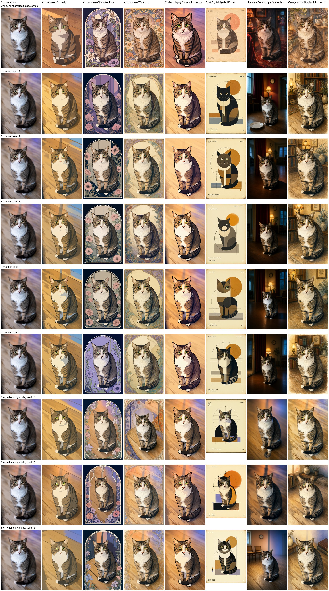

# ComfyUI style transfer

This folder redraws any image in any style of `image-styles/` with a local ComfyUI and Qwen Image 2.1 Turbo, on a GPU with 12 GB VRAM. It has two workflows. Each workflow is complete and works alone.

| Folder | Workflow | Who writes the prompt of the image model |
|---|---|---|
| [`1-enhancer/`](1-enhancer/README.md) | Enhancer | The Qwen 3.5 9B prompt enhancer reads the image and the complete style JSON |
| [`2-storyteller/`](2-storyteller/README.md) | Storyteller | The [storyteller](../storyteller/README.md) draws a scene concept. Then the prompt enhancer writes the prompt, with identity notes of the subjects and a rule-based prompt cleanup. It also has the `direct` and `adapt` modes, and LoRA routing. |

Each workflow folder has its own README with the requirements, the usage, and the options. The models and the ComfyUI setup are the same for the two workflows.

## Example matrix



Column 1 has the source photo [`image-styles/_baseline.png`](../image-styles/_baseline.png). The next columns have the styles in alphabetical order. The rows are:

1. The ChatGPT example images of `image-styles/`
2. Enhancer, five seeds
3. Storyteller (`story` mode, no LoRA), three seeds

To make the matrix again, start ComfyUI. Then run the example sheet tool of each workflow, and collect the images. Run the commands from the repository root:

```bash
python comfyui/1-enhancer/make_example_sheet.py --work work/1 --sheet comfyui/1-enhancer/example-sheet.jpg --server http://127.0.0.1:8188
python comfyui/2-storyteller/make_example_sheet.py --work work/2 --sheet comfyui/2-storyteller/example-sheet.jpg --server http://127.0.0.1:8188
python comfyui/make_example_matrix.py --enhancer-work work/1 --story-work work/2 --sheet comfyui/example-matrix.jpg
```

The two sheet tools run the `style_transfer.py` of their workflow without a change. The README of each workflow shows its full sheet with all seeds.
