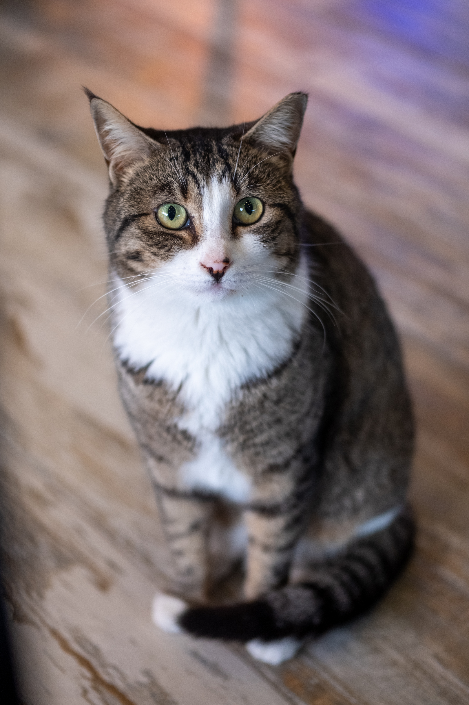

# Example gallery

Each style has its main example and extra examples. ChatGPT made all examples from the same source photo, `_baseline.png`. Use them as a quality reference for a style: they show how ChatGPT reads the style file.

The extra examples are in a folder for each style, with the titles that ChatGPT gave them. The main example is next to the style file, as `<style>.example.png`.

Each row shows, from left to right: the source photo, the main example, and the extra examples.

The source photo is CC0. The repository license does not cover it.

## Anime Isekai Comedy

Style file: [`Anime Isekai Comedy.json`](../Anime%20Isekai%20Comedy.json)

## Art Nouveau Character Arch

Style file: [`Art Nouveau Character Arch.json`](../Art%20Nouveau%20Character%20Arch.json)

## Art Nouveau Watercolor

Style file: [`Art Nouveau Watercolor.json`](../Art%20Nouveau%20Watercolor.json)

## Gothic Stained Glass Character Polyptych

Style file: [`Gothic Stained Glass Character Polyptych.json`](../Gothic%20Stained%20Glass%20Character%20Polyptych.json)

## Modern Happy Cartoon Illustration

Style file: [`Modern Happy Cartoon Illustration.json`](../Modern%20Happy%20Cartoon%20Illustration.json)

## Post-Digital Symbol Poster

Style file: [`Post-Digital Symbol Poster.json`](../Post-Digital%20Symbol%20Poster.json)

## Uncanny Dream Logic Surrealism

Style file: [`Uncanny Dream Logic Surrealism.json`](../Uncanny%20Dream%20Logic%20Surrealism.json)

## Vintage Cozy Storybook Illustration

Style file: [`Vintage Cozy Storybook Illustration.json`](../Vintage%20Cozy%20Storybook%20Illustration.json)

