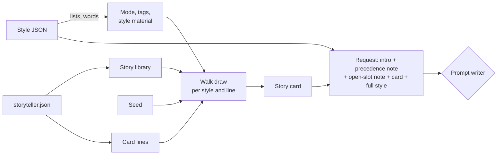

# Storyteller

The storyteller gives each image of a style a different enrichment: a scene concept that adds story, detail, and environment to the picture of the subject. It does not change the style files. It works with any image tool: ChatGPT, a local ComfyUI ([`comfyui/2-storyteller/`](../comfyui/2-storyteller/README.md)), or a prompt that you write yourself.

| File | Use |
|---|---|
| `storyteller.py` | Draws a story card for a style and a seed. Standard library only. |
| `storyteller.json` | The config: the story library, the card lines, the texts, and the probabilities |
| `test_storyteller.py` | The unit tests (standard library only) |

## Why

A style file defines how an image looks: medium, palette, light, texture. It does not say what happens in the image. A model that gets only the style file and a photo makes nearly the same scene each time, because it keeps the setting and the framing of the photo.

The storyteller adds a different **story card** for each seed. A card gives a concept, a setting, a story object, a moment, a mood, and more. The model then makes an enriched picture of the subject in the style. It keeps the subject and its pose, keeps a real place of the input image, and enriches the picture with the card.

## Principles

- **Enrich, do not replace.** The card adds story around the subject. The subject keeps its pose, so a moment is visible evidence around the subject (a door left open, a trail, a delivery), not an action of the subject.
- **The storyteller knows no style.** The code and the config contain no style names and no text for one style. Everything that depends on the style comes from the style file through generic key paths and words.
- **The style has priority.** A line that the style controls defers to it: camera, format, framing, lighting key, empty space, and a place that the style keeps.
- **No names of works.** The code and the config name no film, series, book, game, painting, artist, brand, or person. The homage lines tell the writer to choose the works itself, from the traits of the style.
- **Stageable in one still image.** Each library item is a thing that one picture can show. No item assumes a species or a face, so the cards work for animals, people, groups, objects, buildings, and landscapes.
- **Quietly uncanny, never a sight gag.** Strange items are only for styles with uncanny or mysterious words, and the request asks for an unexpected element that the picture treats as normal.

## How it works



1. **Mode.** The storyteller reads the positive text of the style (never the "no" lists) and finds its mode with the rules of `modes`. A style whose text says, for example, "never as a scene" or "no light and no shading" is `graphic`. A style whose background type or style starts with "Decorative" is `decorative`. All other styles are `scene`. Each mode has capabilities (`caps`): `scene` has `scene`, `light`, and `depth`.
2. **Tags.** The words of `style_tags` in the style text give tags, for example `uncanny`, `comic`, `cozy`, `fantasy`, or `everyday`.
3. **Style material.** The storyteller collects the string lists of the style: settings, story details, moods, expressions, shot types, and influences. It skips "no" lists, lists in a section of low importance, and items with a negation word. It also collects the dotted paths of background keys that name the objects of a place, for example `background_design.furniture`.
4. **Lines.** For each line, it draws the probability and a value. A library item can need capabilities (`needs`, `needs_any`), need a tag (`only`), be blocked by a tag (`unless`), or get a higher weight with a tag (`boost`). The setting adds `indoor` or `outdoor` to the capabilities, so the lines after it fit the place.
5. **Request.** The intro, the precedence note, the open-slot note (when the card has open slots), the card, and the complete style go to the prompt writer.

### Draws without repeats

The same seed always gives the same card. A block of consecutive seeds gives different values: for each style and line, the items get a fixed order (a shuffle), and seed n starts at position n of that order. Thus ten consecutive seeds see ten different settings when the pool has ten or more allowed items. A weight puts an item in the deck more than one time, round-robin. Each line has its own order. The setting decides indoor or outdoor, so a new setting can change the spot, the moment, and the event. The other lines do not depend on each other.

## Story card

Example for a cozy storybook style with seed 4:

```text
Concept: the picture tells this: a journey ends here, and its traces are still visible; the place keeps small traces of earlier visits of the subject. Show this idea with one main story element near the subject that reads at thumbnail size, ...
Setting: enrich the place of the input image with elements of this setting, or surround the subject with it when the input shows no place: a bakery with fresh loaves on the shelves
Spot: the subject is at the end of a long table
Key story detail: work into the story: Fine floral ceramic patterns
Story object: one concrete object in this role, taken from the setting or the specification where one fits: an object that hints at where the subject came from
Moment: around the subject, which keeps its pose: something has just been delivered and stands unopened near the subject
Event: a pale, luminous haze in the far part of the scene
Staging: give the story object the strongest accent color of the palette near the subject
Place details: furnish the setting with the kinds of objects that the specification names in background_design.furniture
Time of day: overcast afternoon with pale, bright, diffuse light
Camera: one of the camera options that the composition of the specification allows
Format: portrait, taller than wide (2:3)
House rule: (open slot) invent one quiet rule that this place obeys, for example that everything faces one direction, and show it
Season: (open slot) decide the season and show one sign of it
Homage: let one well-known film, series, book, game, or painting that you choose give most motifs of this picture. Choose a work that matches these traits of the specification: ..., its mood, and this setting. Put its motifs at these places: ...
```

### Lines

| Line | Source | Probability | Modes |
|---|---|---|---|
| Concept | library `tensions` + `relationships` | 1 | all (graphic: tension only, shapes and marks) |
| Setting | the style's setting list, else library `settings` (`themes` in decorative mode) | 1 | all, with a different frame text for each mode |
| Spot | library `spots` (where in the setting) | 0.6 | scene |
| Key story detail | the style's detail lists | 0.7 | all |
| Story object | library `story_objects` (a role, not a stock prop) | 0.9 | scene, decorative |
| Story mark | library `graphic_marks` | 1 | graphic |
| Moment | library `moments` (visible evidence around the subject) | 1 | scene, decorative |
| Event | library `events` (light, weather, air) | 0.6 | scene, decorative |
| Mood | the style's variable or secondary moods | 0.8 | all |
| Acting | the style's expression lists, when the subject has a face or a body that can act | 0.7 | styles with such a list |
| Staging | library `staging` (how the concept reads) | 0.7 | scene, decorative |
| Place details | the style's background keys for the objects of a place | 0.5 | scene |
| Time of day | a daylight pool | 1 | scene |
| Shot | the style's shot-type list, only when the source shot does not already read as one | 0.5 | styles with such a list |
| Camera | a pool, or the camera options of the style | 1 | cards without a `Shot` line |
| Format | a pool, filtered by the style's aspect ratio | 1 | all |
| Open slots | 2 of the slots that fit the style | 1 | all |
| Homage | visual motifs from works that the writer chooses | 0.35 | all |
| Story homage | a story situation from a work that the writer chooses | 0.3 | all |

### Open slots

An open slot is a line that the writer fills itself, for example `Backstory: (open slot) invent in one clause what happened just before this moment, and show one visible trace of it`. Each card has two slots. Slots that need a scene (for example `Outside the frame` or `Sound`) do not occur in graphic mode. The request then adds `open_slot_note`: fill each slot with one concrete, stageable idea, optionally from a work that the writer chooses, transformed, with no names, characters, logos, or text.

### Homage

The `Homage` line (0.35) tells the writer to choose well-known works that match two or three traits of the style. The traits come from the style's own `influences` lists. The line also gives one to three landing places for the borrowed motifs, for example a floor or wall pattern, a curtain, a food or drink ritual, a recurring animal or symbol, a visible sound source, or a quality of light. Landing places fit the mode: a graphic style gets only a color pairing or a mark.

The line has two variants. In two of three homage cards, motifs come from one to three works. In one of three, one work gives most of the motifs (the dominant homage). The `Story homage` line (0.3) takes a story situation, relationship, or twist from a work that the writer chooses.

### Format and camera

The `Format` line draws portrait (2:3), landscape (3:2), or square (1:1). The style filters the draw: a style that names some formats limits the draw to them, "flexible" only weights them, "preserve the source" gives the source ratio, and one fixed ratio gives that ratio. In ComfyUI, `--canvas auto` uses this line.

If the style defines its composition (`composition.camera` and similar paths), the `Camera` line asks for a camera option that the style allows. If the style lists its shot types, the `Shot` line (0.5) draws one of them instead, used only when the source shot does not already read as one of them.

### Rules, recipes, and budgets

The config has three kinds of parts, so that a new idea combines with the existing material and does not need a new copy of a text:

- **Rules** (`rules`) are named clauses, written once. A line, a slot, or a note inserts one with `{rule:NAME}`. A rule has the same gates as a library item (`only`, `unless`, `needs`, `needs_any`, `modes`): it becomes empty where it does not fit. For example, `one_figure` (the subject is the only figure, others only as traces) and `true_reflections` (a reflection obeys the geometry of the place) apply only to a scene or a decorative style, and `no_titles` keeps the names of works out of every homage line.
- **Recipes** (`recipes`) are card structures. Each seed draws one recipe, with no repeats across consecutive seeds. A recipe sets the probability of lines (`lines`), the budgets (`budgets`), and an optional `note`, which the card shows as its last line `Approach`. For example, `quiet moment` drops the event and the homage and allows two objects, and `surprise-led` builds the picture around its one surprise.
- **Budgets** (`budgets`) limit the number of lines of one `kind` on a card. A line or a slot with `"kind": "object"` adds an object; the default budget is three objects, so a card cannot ask for a ring of props around the subject.

The `Surprise` line draws one idea from the `twists` pool, in the logic of the style: each idea has a tag (`uncanny`, `mystery`, `fantasy`, `comic`, `cozy`, `everyday`), so a cozy style gets a warm small wonder and an uncanny style a quiet impossibility. A style can have several tags (an uncanny style that mentions "comforting familiarity" is also cozy). The tag with the most word matches, and each tag with at least `draw.primary_ratio` (0.75) of its matches, is a primary tag, and `primary_share` (0.75) is the share of draws that take only items of the primary tag.

## Use with ChatGPT (without ComfyUI)

You need only Python 3. Run this from the repository root:

```bash
python storyteller/storyteller.py "image-styles/<style>.json" --seed 1 --request
```

Copy the complete output. Open a new ChatGPT chat, attach your source image, paste the request, and send it. For the next image, use a new seed and a new chat. To make several requests at once, give several seeds: `--seed 1 2 3 --request`.

## Usage

```bash
python storyteller/storyteller.py "image-styles/<style>.json" --seed 1 2 3
python storyteller/storyteller.py "image-styles/<style>.json" --seed 1 --set Homage=1 "Open slots=0"
python storyteller/storyteller.py "image-styles/<style>.json" --seed 1 --config my-story.json
python storyteller/storyteller.py "image-styles/<style>.json" --seed 1 2 3 --recipe "quiet moment"
```

With a local ComfyUI, `story` mode of [`comfyui/2-storyteller/style_transfer.py`](../comfyui/2-storyteller/README.md) uses this module, with `--story-config FILE`, `--story-line LABEL=P`, and `--story-seed`.

Run the tests from this folder: `python -I -m unittest discover -s . -p "test_storyteller.py"`. The tests find `image-styles` in a parent folder, or in the folder of the environment variable `STORYTELLER_STYLES`.

## Config

| Key | Content |
|---|---|
| `request_intro`, `precedence_note`, `open_slot_note` | The texts at the top of a request. The open-slot note is added only when the card has an open slot. |
| `card_heading`, `spec_heading` | The headings above the card and the style text |
| `style_sources` | Which style lists the card can use: `setting_keys`, `detail_keys`, `exclude_keys`, `skip_sections`, `quiet_importance` (a regular expression for a weak section), `negation_words`, `material` (more list groups by key part), and `place_keys` |
| `modes` | The scene modes in order. Each has `when` (`paths` and a regular expression `pattern` over the positive style text) and `caps`. A mode without `when` is the default. |
| `style_tags` | Tags from words of the positive style text |
| `draw.boost_factor` | The weight factor of an item whose `boost` tag the style has |
| `place_words` | Words that make a setting `indoor` or `outdoor` |
| `library` | The story pools. An item is a string or an object with `text` and optional `kind`, `needs`, `needs_any`, `only`, `unless`, `boost`, `weight`. |
| `lines` | The lines of the card, in order |
| `rules` | Named clauses for `{rule:NAME}`: a text, or an object with `text` and the gates of a library item and `modes` |
| `recipes` | Card structures: `name`, `weight`, gates, `lines` (label: probability), `budgets`, and `note` |
| `budgets` | The default maximum number of lines of each `kind`, for example `{"object": 3}` |
| `recipe_label` | The label of the recipe note on the card (default `Approach`) |

Each item of `lines` has a `label`, a `probability`, and one value source:

| Key | Content |
|---|---|
| `text` | A fixed value |
| `pool` | A list of values, with optional `weights` and `style_filter` |
| `source` | A style material group, for example `style_settings` or `moods`. With `library` as well, the library is the fallback. |
| `library` | A library pool |
| `template` | A text with placeholders: `{lib:NAME}`, `{style:NAME}`, and a count range such as `{lib:landings*1-3}` |
| `variants` | Weighted alternative templates: `[{"weight": 2, "template": "..."}]` |
| `slots` | Open slots, each with `label` and `text`, and `count` slots for each card |

Optional keys: `fallback_template` (used when the style has no material for a placeholder), `unless_line` (the line is dropped when the card has this line), `prefix`, `item_prefix` (only before a drawn value), `suffix`, `modes` (the line is used only in these modes), `mode_overrides` (changed keys for one mode), `requires` (a material group that must not be empty), `unless_material` (the line is dropped if this group is not empty), `if_style_has` (the style controls the line), `adds_kind` (the setting adds `indoor` or `outdoor`), `slug` (the file-name slug comes from this line), `primary_share` (the share of draws from the items of the primary style tag), and `kind` (the budget that the line uses). A `--set LABEL=P` override has priority over the recipe and the budget.

To remove a line, set its `probability` to 0. To add a line, add an item with a new `label`.
